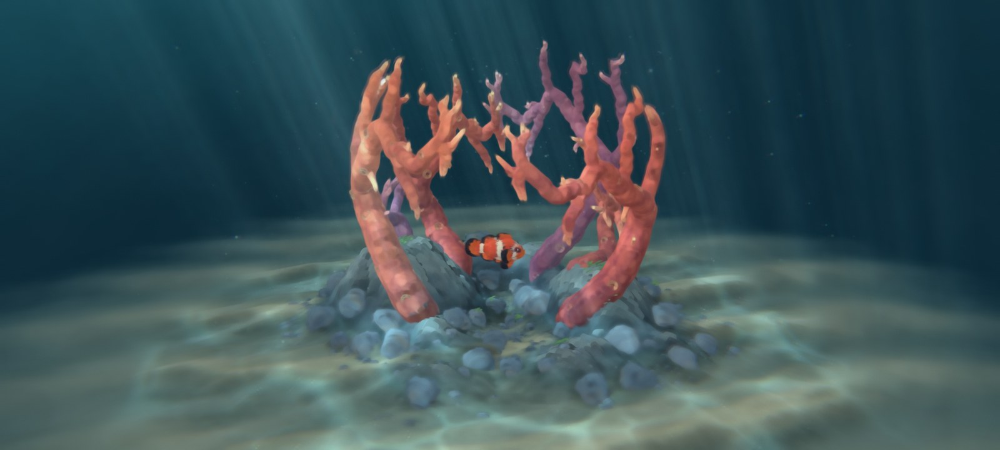
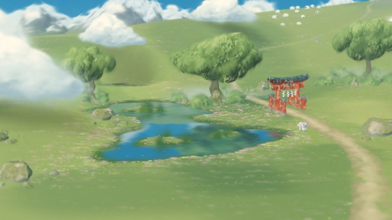
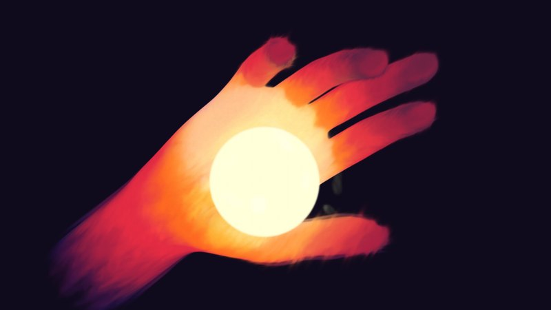
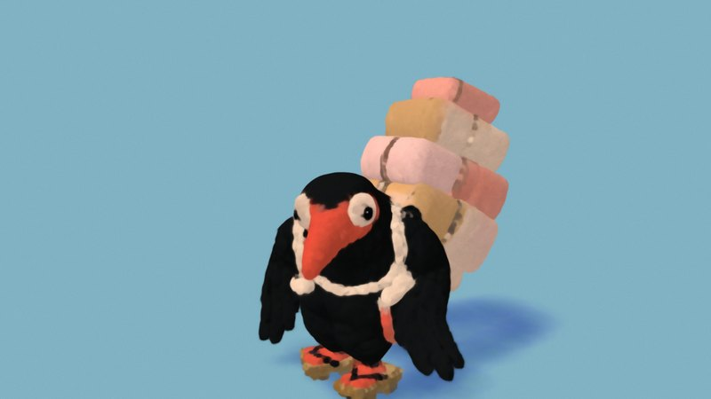
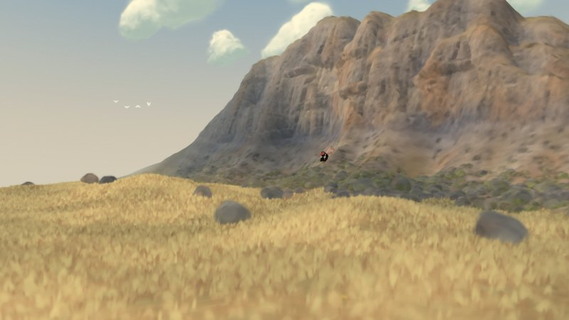
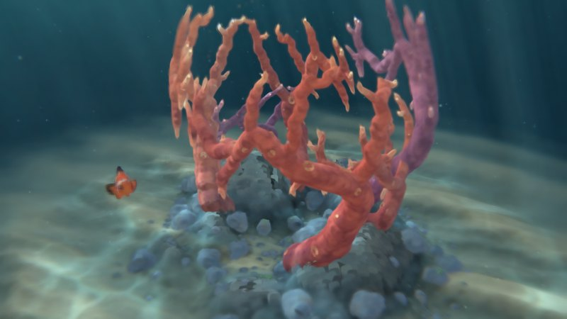
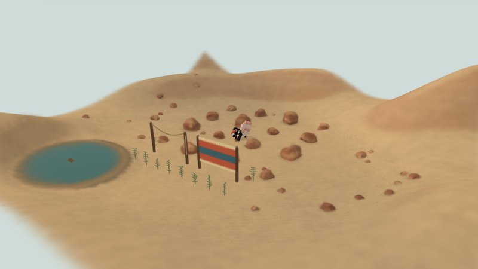
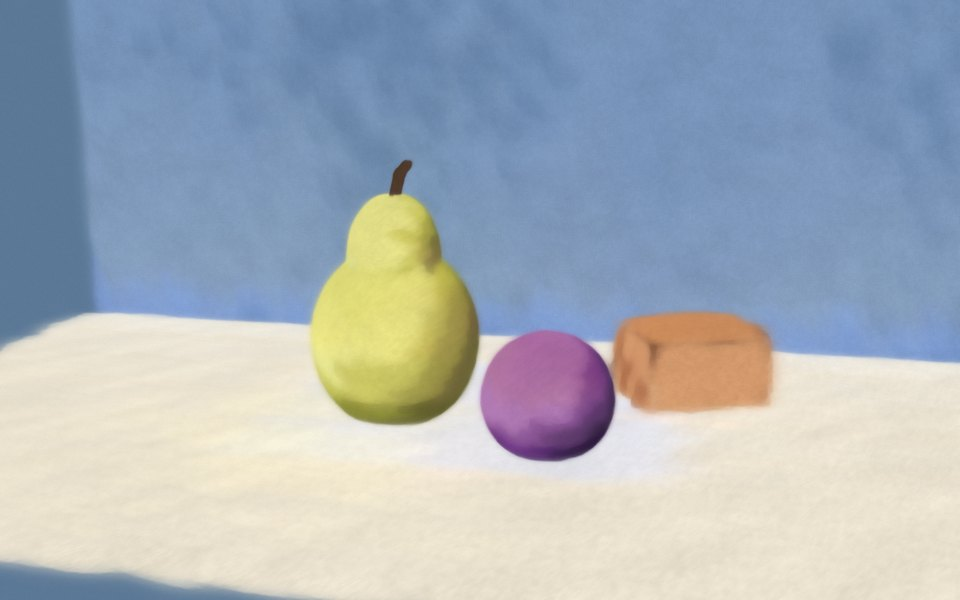

<p align="center">
  <a href="https://sillage3d.vercel.app/coral">
    
  </a>
</p>

# Sillage 3D

A 3D engine for the browser that draws every Gaussian splat as a brush mark. Scenes are real 3D, so you can orbit them, light them and move through them, and every frame still reads as a painting.

**Alpha `0.1.0-alpha.1`** · [Live demos](https://sillage3d.vercel.app) · [Release notes](CHANGELOG.md) · [Getting started](docs/getting-started.md) · [Prompting](docs/prompting.md) · [Reference](AGENTS.md)

The image above is one frame from the engine: the built-in `hollow-reef` scene, rendered from the command line.

## What it is for

Sillage is a specialised engine, not a general one. It does one thing that mesh engines such as Three.js do poorly: **scenes that look painted, and stay painted when the camera moves.**

A mesh engine draws triangles with materials. Toon shading keeps the hard silhouette of the geometry, and a painterly filter over the finished frame belongs to the screen, so its strokes slide or flicker as the view changes. In Sillage the brush marks are the geometry: each one is a small 3D Gaussian with its own place, direction and size in the world, so marks overlap, break an edge, and hold still as you orbit.

| Use it for | Use a mesh engine for |
|---|---|
| Gouache, oil and watercolour scenes in real 3D | Photorealism and physically based materials |
| Stylised levels, dioramas, backdrops, characters and props built from simple volumes | Rigged characters, mesh pipelines, a general game engine |
| Painted atmosphere: mist, smoke, fire, dusk | Hard, clean edges, lettering, fine mechanical detail |

[Prompting Sillage](docs/prompting.md) has worked example prompts for level, character, environment and prop design.

## Demo scenes

Six scenes run live in the browser. Each one opens on its own page.

| | | |
|:---:|:---:|:---:|
| [](https://sillage3d.vercel.app/) | [](https://sillage3d.vercel.app/hand) | [](https://sillage3d.vercel.app/bird) |
| [**Summer meadow**](https://sillage3d.vercel.app/)<br>Painted light, water and wind | [**Thermal hand**](https://sillage3d.vercel.app/hand)<br>Slow waves of heat around an orb | [**Crow courier**](https://sillage3d.vercel.app/bird)<br>A courier carrying a tall stack of parcels |
| [](https://sillage3d.vercel.app/cliff) | [](https://sillage3d.vercel.app/coral) | [](https://sillage3d.vercel.app/physics) |
| [**Four seasons**](https://sillage3d.vercel.app/cliff)<br>A cliff and meadow through the year | [**Coral reef**](https://sillage3d.vercel.app/coral)<br>Growing coral, day and night | [**Physics**](https://sillage3d.vercel.app/physics)<br>Rocks, cloth, water, sand and snow |

The demos need a desktop or recent mobile browser with WebGL2.

## What is in the alpha

- **The engine.** A WebGL2 renderer for brush-mark Gaussian splats, with three ways of drawing a mark (`paint`, `gaussian`, `gouache`), oil and watercolour variants, baked bounce light, depth of field, ambient occlusion and 51 render options.
- **31 built-in scenes.** Landscapes, studies, terrain from survey data, a reef, a physics lab and a playable character.
- **Scene documents.** A scene is a JSON file built from ten forms: `ellipsoid`, `plane`, `box`, `disc`, `cylinder`, `cone`, `tube`, `blob`, hand-placed `splats`, and trained `.splat` files.
- **One API, four ways in.** A JavaScript API for a page, a headless session for Node, a command line, and an MCP server for LLM clients. The command line and the MCP server run the same eight tools.

## Quick start

You need Node 22.12 or newer. Drawing from the command line also needs Google Chrome, which the tools run headless.

```sh
git clone https://github.com/wrong-nebula/sillage3D.git
cd sillage3D
npm install

node cli/sillage.mjs scenes                      # the built-in scenes
node cli/sillage.mjs render alpine               # draw one; prints the PNG path
node cli/sillage.mjs serve                       # the viewer, at /sillage.html?scene=alpine
```

Images go to `output/sillage/`. [Getting started](docs/getting-started.md) walks through a first scene of your own.

## A scene is a JSON document



```json
{
  "sillage": 1,
  "background": "#5b7896",
  "style": {"mode": "gouache", "softness": 0.15},
  "content": [
    {"type": "plane", "size": [9, 5],
     "color": ["#a99a84", "#d8cdb6", "#ebe2cf"]},
    {"type": "ellipsoid", "center": [0.6, 0.4, 0.7],
     "radius": 0.4,
     "color": ["#2a1633", "#4d2456", "#7a3a7c"],
     "stroke": {"direction": "around"}}
  ]
}
```

A list of colours from dark to light is shaded in steps by how each mark faces the light, which is what gives the painted look. The picture on the right is the `still-life` starter scene.

```sh
node cli/sillage.mjs new scenes/still.json       # write a starter scene
node cli/sillage.mjs inspect scenes/still.json   # check it in milliseconds, no browser
node cli/sillage.mjs render scenes/still.json    # draw it
node cli/sillage.mjs views scenes/still.json     # four sides in one labelled image
```

<br clear="right">

## Use it from code

In a page:

```js
import {createSillage} from './src/sillage/index.js';

const sillage = await createSillage(canvas, {scene: 'alpine'});   // or a scene document
sillage.setStyle({mode: 'gouache', softness: 0.3});
sillage.orbit(40, 10);
const png = await sillage.capture({width: 1024});                 // a PNG Blob
```

In Node, with the real renderer in headless Chrome:

```js
import {openSession} from './cli/index.mjs';

const session = await openSession({width: 1280, height: 800});
await session.load('cliff-talus');
await session.setParameters({season: 0.5});                       // winter
const {png} = await session.capture({width: 1024});               // a Buffer
await session.close();
```

From an LLM client, as an MCP server:

```sh
claude mcp add sillage -- node "/absolute/path/to/sillage3D/cli/sillage.mjs" mcp
```

Every error carries a stable `code` and a `hint` that says what to send instead.

## Documentation

| | |
|---|---|
| [Getting started](docs/getting-started.md) | Install, draw a built-in scene, write and check a scene of your own. |
| [Prompting Sillage](docs/prompting.md) | What the engine is for, how to brief a model, and example prompts with their results for level, character, environment and prop design. |
| [Reference](AGENTS.md) | Every command, the scene format, render options, the JavaScript API, states and error codes. Written for people and for agents; `sillage guide` prints it. |
| [How the rendering works](docs/gaussian-brush-method.md) | How a Gaussian splat becomes a brush mark, with measurements. |
| [Physics](docs/splat-physics.md) | The splat physics lab: rocks, cloth, water and ground materials. |
| [Release notes](CHANGELOG.md) | What each release contains. |
| [Third-party notices](docs/third-party-notices.md) | Code and assets from other authors, with their licences. |

## Status

This is an alpha. It is usable and tested, and it will change.

- Names, options and the scene format may change between alpha releases. The release notes will say what moved.
- Drawing needs a browser with a GPU. From the command line that is installed Google Chrome, run headless.
- A render from the command line takes 2 to 4 seconds, most of it starting the browser, and about 7 for the largest built-in scenes. The MCP server keeps one browser open, so later renders are faster.
- Scene documents use a small set of forms, so organic subjects are approximations.
- Built-in scenes cannot be exported to `.splat`; scene documents can.

```sh
npm test                         # everything that needs no browser
node tests/browser-sillage.mjs   # the API end to end, in headless Chrome
```

## Licence

Sillage 3D is not open source yet. The code and scenes in this repository are © 2026 wrong-nebula, all rights reserved; see [LICENSE.md](LICENSE.md). Bundled work by other authors keeps its own licence, listed in the [third-party notices](docs/third-party-notices.md).
