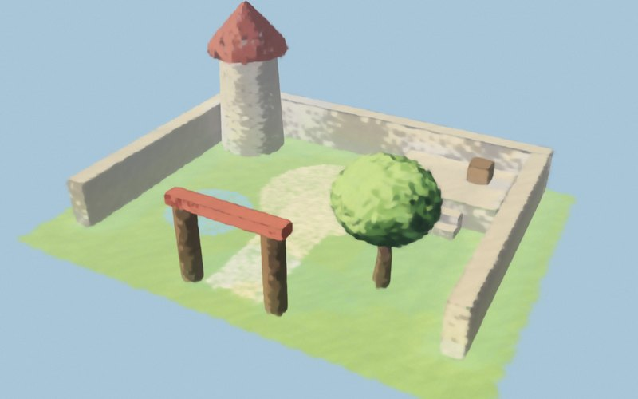
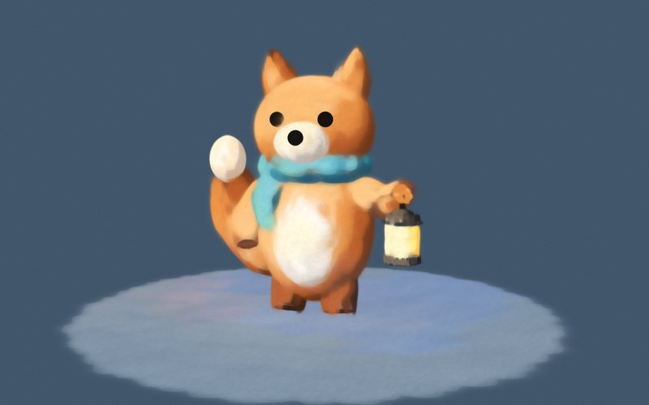
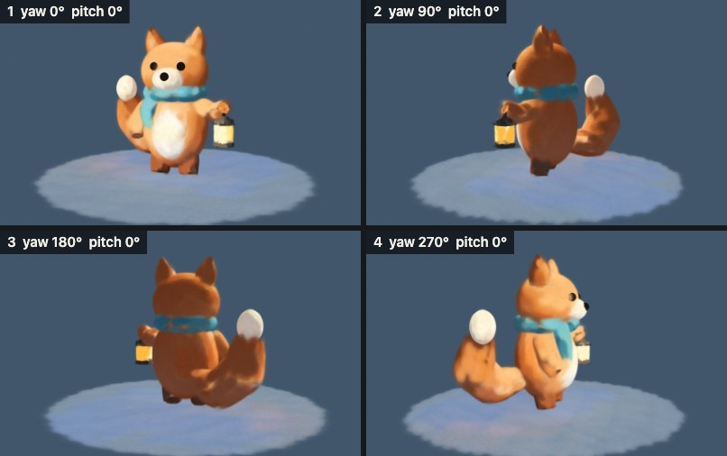
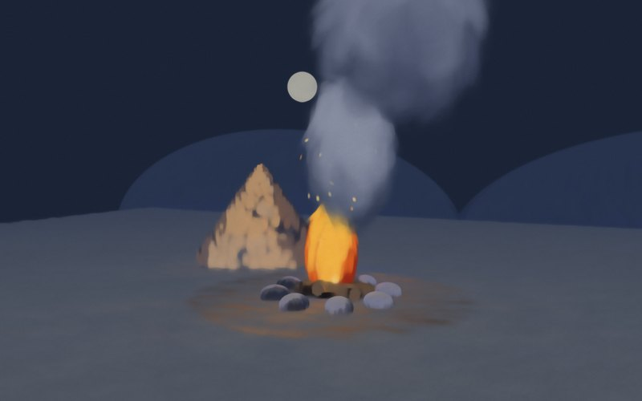
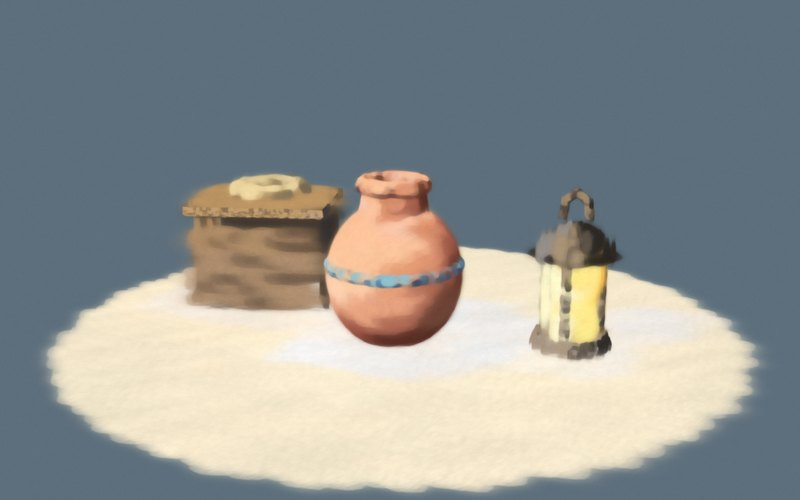

# Prompting Sillage

How to ask a model for a scene and get a good one. The prompts here are written for an LLM that has the Sillage tools, through the [MCP server](../AGENTS.md#mcp) or the command line. Each example is real: a model wrote the scene document from a request like the one shown, over two rounds of render and revise, and the picture beside it is that document drawn by the engine. The documents are in [`docs/examples/`](examples/).

## What this engine is for

Sillage is a specialised engine. It does one thing that general 3D engines do poorly: **scenes that look painted, and stay painted when the camera moves.**

In a mesh engine such as Three.js, a surface is triangles with a material. You can push it toward a painterly look, but each route has a cost: toon shading keeps the hard silhouette of the geometry under it, and a painterly filter over the finished frame belongs to the screen, so its strokes slide or flicker as the view changes. In Sillage the brush marks are the geometry. Each mark is a small 3D Gaussian with a position, a direction and a size in the world, so marks overlap, break an edge, and hold their place as you orbit.

Ask it for:

- illustrated, gouache, oil or watercolour scenes
- stylised levels, dioramas and backdrops
- characters and props built from simple volumes
- painted atmosphere: mist, smoke, fire, dusk
- pictures where the handling of the paint is part of the subject

Do not ask it for:

- photorealism, or physically based materials
- exact likenesses, lettering, logos or fine mechanical detail
- hard, clean edges: a mark is soft by nature
- a general game engine: there are no meshes, no rigging and no timeline in a scene document

If the job is a realistic product shot or a mesh-based game, use a mesh engine. If the job is a picture that should look as though someone painted it, in 3D, this is the tool. (Sillage uses three.js underneath for its WebGL plumbing; the difference is in what gets drawn.)

## Give the model its working method first

Put this before any scene request. It makes more difference than any detail of the request itself.

```text
You are building a scene for Sillage, an engine that draws 3D scenes as brush marks.

Method:
1. Call scene_format once to read the format. Use only its content types:
   ellipsoid, plane, box, disc, cylinder, cone, tube, blob.
2. Write the scene as one JSON document. +Y is up; the viewer stands on the +Z
   side looking toward -Z. Make the main subject 2 to 3 units tall.
3. Call inspect_scene. Fix every error and every warning before drawing.
4. Call render and look at the image. Then call render_views to see it from
   four sides.
5. Say what is wrong with the picture in one or two sentences, change only
   that, and repeat from step 3. Stop after three rounds or when nothing is
   wrong.

Rules for the look:
- Give every form with volume a colour ramp of 3 to 5 tones from dark to
  light, not one flat colour. The light picks the tone.
- Keep to a palette of five or six named colours and reuse them.
- Lay strokes along the form: "around" for round things, "up" for fur, grass
  and flame, along the grain for wood and cloth.
- One item per thing, each with an "id".
- Things that give light (flames, lamps, eyes, the moon) are "unlit".
- Smoke, cloud and mist are a "blob" with material "cloud" and a low opacity
  range such as [0.1, 0.35].
```

## Practices that hold for every scene

1. **Name the forms.** "A tower: a tapered cylinder with a cone roof" gets a tower. "A medieval tower" gets a guess. The eight forms are the vocabulary, so think in them.
2. **Fix the scale.** A subject 2 to 3 units tall with the camera 8 to 12 units away suits the default mark sizes. A scene a hundred units wide needs its marks sized by hand.
3. **Ramps, not colours.** A list of colours from dark to light is shaded in steps by how each mark faces the light. That stepping is the painted look. One flat colour reads as a cut-out.
4. **Few colours, reused.** Put them in `palette` and refer to them by name. Scenes with five or six colours look composed; scenes with twenty look assembled.
5. **Stroke direction is drawing.** It says what a surface is made of before colour does.
6. **Coverage comes from mark size, not count.** A few hundred to a few thousand marks per item is normal, 5,000 to 60,000 for a scene. If the background shows between marks, make the marks larger rather than more numerous. `inspect` warns about this.
7. **Use fog for depth, and know it reaches everything.** `atmosphere` pushes distant forms back. It also fogs distant lights: a moon placed far beyond the fog's range disappears. Keep it inside the range, or lower `max`.
8. **Leave the camera out at first.** The content is framed for you. Add a camera once the scene is right.
9. **Look from all sides.** `render_views` shows what the hero view hides. In the character below, the pale tail tip reads as a raised paw from the front and is plainly a tail from the side.
10. **Change one thing per round.** Frames are frozen by default, so two renders differ only by your edit.

## Level design



```text
Block out a small walled courtyard level, seen from a high three-quarter view
so the whole layout reads at once.

Layout, on a 16 x 12 grass plane:
- stone walls 1.8 high on the back, left and right; the front is open
- a wooden gate at the front centre: two posts and a red beam
- a sand path from the gate to a round sand plaza in the middle
- a raised stone platform, 1 high, back right, with two steps up to it,
  and a wooden crate on top as the goal
- a round stone tower with a red cone roof in the back left corner
- a pond front left, one tree front right

Use three ramps only: stone, wood, grass. Red for the roof and the beam.
Gouache, slight softness, a little distance fog.
```

[`examples/level-courtyard.json`](examples/level-courtyard.json) · 18 items, about 26,000 marks

Why it works:

- **Measurements, not adjectives.** Heights and a ground size give the model a grid to place things on, and give you numbers to change.
- **Positions as a map.** "Back left", "front centre" and "in the middle" are unambiguous in a top-down layout.
- **A stated view.** A level is judged from above; saying so stops the model framing it as a postcard.
- **Three ramps.** Walls, platform, steps and tower share one stone ramp, so the level reads as one place.

To iterate, ask for one change at a time: "raise the platform to 1.6 and add a third step", "move the pond behind the plaza". Ask for `render_views` when a path or a sightline matters.

<br clear="right">

## Character design



```text
Design a small fox spirit, about 2.4 units tall, standing upright and holding
a lantern in one hand. Friendly, round, readable as a silhouette.

Build it from simple volumes:
- body and head as ellipsoids, the head about three quarters the body's width
- a cream belly and muzzle as flatter ellipsoids set into the surface
- cone ears, tilted outward
- arms, legs and a thick curling tail as tapered tubes
- a teal scarf: a tube ring around the neck, with one loose end
- eyes and nose as small dark unlit ellipsoids, set on the head's surface,
  not inside it
- the lantern: a metal cap and base, and an unlit warm cylinder for the light

Orange fur as a four-tone ramp, strokes running up the body and around the
head. Stand it on a plain disc, against one flat mid-blue. Then show me a
four-view turnaround.
```

[`examples/character-lantern-fox.json`](examples/character-lantern-fox.json) · 22 items, about 4,600 marks



Why it works:

- **A part list.** Characters fail when the model has to invent anatomy. Naming the volume for each part removes the guessing.
- **Proportions as ratios.** "The head about three quarters the body's width" survives a change of scale.
- **Features on the surface.** Eyes placed at the centre of the head vanish inside it. Say where they sit.
- **A plain stage.** A flat background and a disc keep the silhouette legible, which is what a character sheet is for.
- **The turnaround is part of the request.** It is how you find the part that only works from one side.

A character here is a painted sculpture, not a rig: it holds one pose. For a different pose, ask for the pose and let the model move the tubes.

<br clear="right">

## Environment and effects



```text
Paint a campfire at dusk on an open shore. The fire is the only warm thing
in a cold blue scene.

- ground: one large dark plane, with a soft warm disc under the fire for its
  glow on the sand (unlit, low opacity)
- the fire: a ring of eight small stones, three crossed logs, and two nested
  flame blobs: an outer one from deep red to orange, an inner one from orange
  to near white. Both unlit, strokes pointing up, the outer one partly
  transparent.
- sparks: a few dozen tiny unlit marks scattered above the flame
- smoke: two cloud blobs rising and drifting to one side, cool grey, opacity
  around 0.1 to 0.35, with large loose strokes
- a small tent beside the fire, two low hills far behind, a pale moon
- night-blue background and fog of the same blue, starting just past the fire

Softer edges than usual. Keep the moon inside the fog's range so it stays
visible.
```

[`examples/vfx-campfire.json`](examples/vfx-campfire.json) · 22 items, about 20,000 marks

Why it works:

- **One idea for the colour.** "The only warm thing in a cold scene" decides every palette choice the model will make.
- **Light is declared.** `unlit` keeps flames, sparks and the moon at the colour you wrote, with no shadow baked onto them.
- **Glow is painted.** There are no dynamic lights in a scene document. The light a fire throws on the ground is a warm, transparent disc, as a painter would do it.
- **Smoke is a form.** A `blob` with material `cloud`, low opacity and big loose strokes reads as smoke, and casts no shadow.
- **Fog sets the depth.** The hills are the same blue as the fog, a little darker, so they sit far back without detail.

Effects in a scene document are still. There is no particle system or timeline in the format: fire, smoke, rain and mist are painted as forms. Moving wind, water, seasons and characters exist in the built-in scenes, through `--motion` and `setMotion`.

<br clear="right">

## Props



```text
Make a set of three props for review, side by side on a round pale cloth,
each about 1 to 1.5 units tall, with space between them:

1. a wooden crate with a slightly larger lid and a coil of rope on top.
   Strokes run along the planks.
2. a round clay jar: an ellipsoid body, a short tapered neck, a rim, and one
   thin blue band around the widest part. Strokes run around it.
3. a metal lantern: a base, four thin posts, a cone roof with a ring handle,
   and an unlit warm cylinder inside for the light.

A different material for each: wood, terracotta, dark metal. Smaller marks
than usual so the shapes stay crisp. Plain grey-blue background, a camera a
little above eye level.
```

[`examples/props-set.json`](examples/props-set.json) · 16 items, about 5,300 marks

Why it works:

- **A review layout.** Several props on one plain surface, evenly spaced, can be compared in one render and one turnaround.
- **Construction per prop.** Each is a short stack of forms: body, neck, rim; base, posts, roof.
- **Material through stroke.** Along the planks for wood, around the body for thrown clay. The `material` field then guides the baked light.
- **Mark size stated.** Small objects need smaller marks, or their edges dissolve.

Thin parts are the limit. Posts, cords and handles are tubes of only a few marks each, so ask for them slightly thicker than life.

<br clear="right">

## More prompts that work

**Change the medium, keep the scene.**

```text
Render the same scene three ways and show me all three: gouache as it is; oil
(style oil: true); watercolour (style watercolor: true). Change nothing else.
```

**A mood pass.**

```text
Keep every form where it is. Re-light the scene for early morning: move the
light low and to the left, shift each ramp's lightest tone toward warm yellow
and its darkest toward blue-violet, and add a thin pale fog.
```

**A critique round.** Use this when a render is close but not right.

```text
Look at the render. Name the single weakest thing in it: a form that reads
wrong, a colour that does not belong, a gap where the background shows
through, or a stroke direction that fights the form. Fix only that and
render again.
```

**From a reference description.**

```text
I will describe a picture. First reply with a parts list: each thing in it,
the form you will use, and its ramp. Wait for my go-ahead before writing JSON.
```

## When the result is poor

| What you see | What to ask for |
|---|---|
| Background showing between marks | Larger marks on that item (`stroke.length`, `stroke.width`), not a higher `count`. |
| Flat, cut-out shapes | A ramp of 3 to 5 tones in place of the single colour. |
| A muddy, grey picture | Fewer colours; push the darkest and lightest tone of each ramp further apart. |
| Edges too soft to read | Lower `softness`, smaller marks, or `mode: "paint"`. |
| A light that looks dirty | `unlit: true` on it. |
| Something missing from the frame | Remove `camera` and let the scene be framed, or read the `inspect` warning: it names what is out of frame. |
| A distant object gone | It is past the fog. Move it nearer or lower `atmosphere.max`. |
| A detail that looks right from one side only | `render_views`, then fix the part by name. |
